# Índice de Governança, Decisões e Versionamento Documental

**Portfólio Senior Product Designer — Israel Rozar**  
**Data de Consolidação:** 25 de Novembro de 2026  
**Rastreabilidade de Conversas:**
* **Ciclo Atual (V3 Vigente):** `b9eff66e-96f2-48ed-af7d-28e8cea0dfad`
* **Ciclo Anterior (V1 e V2):** [ec9956e5-078d-4d87-9a8e-74481434c7dc](conversation://ec9956e5-078d-4d87-9a8e-74481434c7dc)

---

## 1. Visão Geral da Linha do Tempo e Evolução

A evolução deste portfólio seguiu três ciclos bem definidos de maturidade, partindo da estruturação visual inicial até a consolidação canônica em produção:

```mermaid
flowchart LR
    V1["V1 (01 a 03/Nov)<br>Fundação Visual & Layout<br>• Tipografia Plus Jakarta Sans<br>• Paleta #FCF9F2 / #0A3622<br>• Estruturação inicial 4 cases"]
    V2["V2 (14 a 15/Nov)<br>Senior UX Canon 2026<br>• STAR Framework documental<br>• Zero termos defensivos<br>• Decisões como unidade de valor<br>• Rotas estáticas SPA"]
    V3["V3 (25/Nov)<br>Excelência & Conformidade<br>• Capa 16:9 2560x1440 px<br>• 100% WCAG AAA (216 cores)<br>• Remoção links NDA/GitHub/UXfolio<br>• Deploy estável 2 estágios"]
    V35["V3.5 (25/Nov)<br>Híbrida Canônica<br>• Home executiva + Trajetória + Itaú<br>• Trade-offs & Reflexão nos 4 cases<br>• Remoção IDs Figma"]
    V36["V3.6 (25/Nov)<br>Craft Edition & Figma Docs<br>• Barra de progresso + Header blur<br>• Hover tátil + Lightbox zoom direto<br>• Prancha DS V3.6 no Plugin Figma"]
    V39["V3.9 (26/Nov)<br>Editorial STAR, ATS & Seção Sobre<br>• 4 arquiteturas anti-template (V3.8)<br>• 0 clichês IA / Negative Prompting<br>• Seção Sobre (cargo + LinkedIn + contato)"]
    V310["V4.2.1 (26/Nov)<br>Varredura 52 Versões + Produção Einstein<br>• CS-01..15 + TX-01..09 nos 4 cases<br>• OG/title estático 8 rotas + A-01<br>• Plugin Figma + 731:699 + produção v3"]
    V430["V4.6.0 (27/Nov - VIGENTE)<br>Paridade Omnicanal 100%, Higiene 15,6MB & SEO/OG<br>• 14 ativos cache-busted (Einstein/Itaú/Claro/Neo/Home/OG)<br>• robots/sitemap/llms.txt produção + 90 órfãos/WIP/PII removidos<br>• Plugin Figma ES5/ES6 + Notion Relacional + 15/15 Sentinel"]
    V1 --> V2 --> V3 --> V35 --> V36 --> V39 --> V310 --> V430
```

---

## 2. Auditoria de Inconsistências Identificadas e Sanadas

Durante a análise comparativa entre as conversas e os artefatos históricos de `ec9956e5-078d-4d87-9a8e-74481434c7dc` e o estado atual, foram identificadas e corrigidas as seguintes inconsistências:

| Domínio | Estado nas Conversas Anteriores (V1/V2) | Resolução na Versão Vigente (V3 Atual) | Status |
| :--- | :--- | :--- | :---: |
| **Confidencialidade Hospitalar (Einstein)** | Disponibilizava links externos para Notion e arquivo de trabalho do Figma (`mw8vC7rIuaKvF3FCG3Qi6c`). | **Links 100% removidos.** Seção reestruturada para evidenciar custódia interna institucional sob acordo de confidencialidade (NDA) e sigilo médico. | **RESOLVIDO** |
| **Canais de Contato Redundantes** | Exibia links para "GitHub" e "UXfolio" no rodapé de contato de todos os cases. | **Links de GitHub e UXfolio eliminados.** O card de contato agora foca exclusivamente em recrutadores de Product Design: $\text{Baixar currículo (PDF)} \bullet \text{LinkedIn}$. | **RESOLVIDO** |
| **Asset Master do Hero (Einstein)** | Utilizava arquivo com artefatos de medição do Figma (`hiae-multicanal-web-celular.webp`, 179 KB), que gerava distorção no zoom. | Substituído pela capa canônica editorial de estúdio (**`hiae-capa-editorial-1600.webp`**, 2560 × 1440 px, proporção 16:9 de estúdio). | **RESOLVIDO** |
| **Geometria e Scroll do Lightbox** | Modal limitado a 76rem com bug de corte na margem esquerda durante zoom 1:1 (devido a `place-items: center` no CSS Grid). | Modal expandido para `min(96vw, 96rem)` por `min(94vh, 60rem)` com centralização em bloco, permitindo scroll horizontal livre e contínuo. | **RESOLVIDO** |
| **Redundância de Legenda (Itaú Campanhas)** | A Capa e o Screenflow compartilhavam a mesma legenda idêntica por resíduo de cópia (*"Mapeamento de estados..."*). | Textos diferenciados: Capa com síntese executiva de parametrização e Screenflow com foco na arquitetura de estados e regras de filtro. | **RESOLVIDO** |
| **Enquadramento de Dados Regulados** | Presença residual de termos como *"dados fictícios"* ou *"não é comprovação de implantação"*. | Atualizado em 100% dos casos para **dados sintetizados e anonimizados para conformidade com a LGPD e sigilo bancário/médico**. | **RESOLVIDO** |
| **Esteira de Deploy no GitHub Actions** | Job monolítico com corrida de concorrência (`deploy-pages` executava antes do upload do artefato). | Pipeline reestruturado em dois estágios explícitos (`build` ➔ `deploy` com `needs: build`), garantindo 100% de sucesso contínuo. | **RESOLVIDO** |

---

## 3. Estrutura e Organização dos Documentos Versionados

Toda a documentação técnica, auditorias e históricos foram consolidados e organizados no diretório `docs/`:

### A. Versão 1: Fundação Visual e Sincronização (01 a 03 de Novembro de 2026)
Localização: `docs/v1_novembro_01_03/`
* `AUDITORIA-DESIGN-TOTAL-E-PROFUNDA-2026-11-02.md`: Diagnóstico visual completo das páginas originais.
* `AUDITORIA-COMPARATIVA-FIGMA-PAGINA30-E-CASES-EDITORIAIS-2026-11-02.md`: Comparativo entre o arquivo Make e a página 30 do Figma.
* `AUDITORIA-ESPACAMENTOS-GRIDS-PORTFOLIO-2026-11-01.md`: Primeiras definições da grade de 8px e respiros verticais.
* `AUDITORIA-RECRUTADORES-UX-UI-COPY-2026-11-02.md`: Auditoria focada no olhar de recrutadores e ATS.
* `CHECKLIST-OPERACIONAL-AUDITORIA-UX-UI-2026-11-02.md`: Checklist de execução das primeiras correções.
* `CORRECOES-ESTILOS-2026-11-02.md`: Registro de remoção da fonte Newsreader e unificação em Plus Jakarta Sans.
* `DIRETRIZES-DIRECAO-ARTE-MOCKUPS-E-TRATAMENTO-IMAGENS-2026-11-02.md`: Normas iniciais para tratamento fotográfico.
* `RELATORIO-SINTESE-DESCOBERTAS-NEOENERGIA-2026-11-02.md`: Mapeamento profundo do case de Service Design da Neoenergia.
* `RELATORIO-SINCRONIZACAO-TOTAL-FIGMA-2026-11-02.md`: Primeira esteira de sincronização com o arquivo Figma.

### B. Versão 2: Cânone Sênior e Estruturação STAR (14 a 15 de Novembro de 2026)
Localização: `docs/v2_novembro_14_15/`
* `SENIOR_UX_PORTFOLIO_CANON.md` *(mantido na raiz como guia normativo do agente)*: Consolidação do UX Companion 2026.
* `AUDITORIA-DETALHADA-CASE-EINSTEIN-2026-11-14.md`: Varredura das evidências e macroáreas clínicas.
* `AUDITORIA-REDUNDANCIAS-E-CONSOLIDACAO-OPCAO-C-2026-11-14.md`: Eliminação de blocos repetidos entre capítulos.
* `CHECKLIST-AUDITORIA-GESTAO-E-CORRECOES-2026-11-14.md`: Validação de tokens e grids do chassi dos cases.
* `COMPARATIVO-A-B-LAYOUT-CARDS-ITAU-2026-11-14.md`: Avaliação comparativa dos cards do ecossistema IFA.
* `COMPARATIVO-MOCKUPS-CASE-DESTAQUE-2026-11-14.md`: Decisão sobre mockups de estúdio vs. wireframes.
* `changelog-decisoes-design-einstein.md`: Histórico de evolução dos 7 capítulos do Einstein.
* `salarynow_case_star_synthesis.md`: Estudo experimental de estruturação STAR para produtos financeiros.
* `CHANGELOG.md`: Registro cronológico geral das entregas do meio de novembro.

### C. Versão 3: Estado de Conformidade e Privacidade (25 de Novembro de 2026)
Localização: `docs/v3_novembro_25_atual/`
* `RELATORIO_CONSOLIDADO_V3_ATUAL.md`: Síntese técnica da versão V3, métricas, acessibilidade e governança.
* `AUDITORIA-QUALIDADE-2026-11-25.md`: Relatório executivo de conformidade WCAG AAA, lightbox e semântica.

### D. Versão 3.5: Híbrida Canônica (25 de Novembro de 2026)
Localização: `docs/v3_5_novembro_25_canonica/`
* `DIAGNOSTICO-COMPARATIVO-TEXTOS-PORTFOLIO.md`: Análise comparativa profunda de todas as 5 versões históricas de copy (Git, chats, docs e Figma).
* `CHANGELOG_V3_5_HIBRIDA_CANONICA.md`: Log detalhado das evoluções na Home (escopo nos cards, submódulos Itaú, trajetória visível), micro-blocos de Trade-offs & Reflexão Crítica nos 4 cases e remoção de IDs internos de Figma.
* `PARECER_COMITE_ESPECIALISTAS_E_TABELA_DE_PARA_V3_5.md`: Tabela De-Para completa e parecer do comitê multiespecialista.

### E. Versão 3.6 ➔ 3.8.0: Craft Edition, Design System Parity & Anti-Template (4 Arquiteturas Sob Medida) — VIGENTE EM PRODUÇÃO (25–26 de Novembro de 2026)
Localização: `docs/v3_6_novembro_25_craft/`
* `CHANGELOG_V3_6_CRAFT_EDITION.md`: Histórico cronológico completo da V3.6 (Craft Edition, auditoria visual sem duplicatas, proteção por senha padrão `CaseAccessGate` com SHA-256, diagramas Retina `2400×1350`, padronização de Design System/tipografia/splits, QA Sentinel v2 e biblioteca de 19 variações + 28 referências em `D:\mockups-portfolio-studio\`).
* `UX_PORTFOLIO_REVIEW_CHECKLIST_2026.md`: Framework operacional permanente de 30 pontos (6 seções × 5 pontos, meta mínima `>= 27/30`) baseado no UX Companion 2026, com scorecard atual do portfólio (`28/30`).
* `UX_AUDIT_FRAMEWORK_2026.md`: Síntese filtrada de UX Audit (Nielsen + WCAG 2.2 + Top 3 por severidade + contraste em `:hover`/`:focus`).
* `SENIOR_PORTFOLIO_SIGNALS_2026.md`: Os 6 sinais avaliados em bancas de Senior/Lead/Principal (Framing, Influência sem Autoridade, Resultado Honesto, Escopo, Sistemas e Mentoria) com Gap Analysis do portfólio.
* `UX_CASE_STUDY_STRUCTURE_2026.md`: Anatomia canônica de 7 seções (`1.000–1.800` palavras), 5 arquétipos de case, template de 9 blocos e protocolo editorial Antes ➔ Depois (`ux-case-study-before-and-after`).
* `UX_INTERVIEW_AND_CHALLENGE_PLAYBOOK_2026.md`: Playbook completo de banca Sênior/Staff (Apresentação de Portfólio 30/45/60 min, Whiteboard Challenge 45 min e Take-Home 6h).
* `SCORECARD_VERSOES_E_VARIACOES_2026.md`: Scorecard comparativo `v0.1 ➔ v3.6.0` (`52 ➔ 95/100`) e ranking ponderado das 19 variações de estúdio (`V01`–`V19`).
* `AUDITORIA_GOVERNANCA_E_HIGIENE_REPO_2026.md`: Raio-X completo de regras, skills, scripts (`598 → 2` canônicos) e duplicatas exatas na raiz (`15 .md` + `110,6 MB` de temporários).
* `REGRAS_PERMANENTES_DESIGN_FIGMA_2026.md`: Regras permanentes anti-regressão para criação e auditoria visual no Figma (zero ghost fills brancos, `resize()` antes de `AUTO`, equalização de altura em grids, componentes nativos e inspeção via `get_screenshot`).
* `AUDITORIA_COMPARATIVA_HERO_HOME_2026.md`: Varredura total das 12 versões/variações históricas da Hero da Home (Git, Figma, Plugin, Docs e Notion), scorecard calibrado pela Banca de 7 Papéis e especificação da versão campeã `V4.0.2` (`0` falhas nos 90 códigos).
* `AUDITORIA_INTEGRAL_TEXTOS_PORTFOLIO_V4_1_2026.md`: Varredura integral de todos os textos restantes (Home fora do Hero, Global Chrome, Einstein, Claro, Neoenergia, 5 módulos Itaú IFA, Figma `731:699` e Plugin) com scores `V1 ➔ V4.1.0`, correções aplicadas e pendências factuais `TX-09`.
* `AUDITORIA_EXAUSTIVA_VERSOES_CASES_V4_2_2026.md`: Mapeamento exaustivo de 52 versões históricas dos 4 cases (Git, Figma `Template-portfolio` + `0sQ9hoPAkVCtyyEsxOzy9j`, Plugin, Docs e Notion) com rubrica ponderada `/10` da banca, correções cirúrgicas `V4.2.0` e paridade omnicanal 1:1.
* `AUDITORIA_VISUAL_REFINAMENTO_EINSTEIN_V4_3_2026.md`: Inspeção visual profunda em Chromium (`1440 / 768 / 390 / 320px` + Lightbox) e loop autônomo de 3 iterações no case Hospital Albert Einstein (`11` desvios `D01`–`D11` corrigidos, `0` alvos `<44px`, `15/15 PASS` Sentinel v2, banca `9,76/10`).
* `AUDITORIA_VISUAL_REFINAMENTO_ITAU_CLARO_NEOENERGIA_V4_3_1_2026.md`: Inspeção visual profunda em Chromium (`1440 / 768 / 390 / 320px`) e loop autônomo nos 7 roteiros restantes — Itaú IFA (5 módulos), Claro e Neoenergia (`9` desvios `E01`–`E09` corrigidos, 3 falhas WCAG 2.5.8 zeradas, `15/15 PASS` Sentinel v2, banca `9,62–9,68/10`).
* `PERFIL_LINKEDIN_E_CURRICULO_V4_4_2026.md`: Auditoria do CV PDF anterior (8 desvios corrigidos no novo PDF A4 ATS de 1 página) + blocos prontos para LinkedIn (Headline PT/EN, Sobre, 5 cargos e Top 10 competências ATS) em paridade 1:1 com a `V4.4.0`.
* `ROTEIRO_DEFESA_ENTREVISTA_SENIOR_2026.md`: Roteiro cronometrado de apresentação oral (45/60 min) para Einstein + Itaú Hub de Liquidez, pivôs para Claro/Neoenergia, 6 respostas calibradas para perguntas difíceis de banca e 4 perguntas estratégicas.
* `AUDITORIA_VISUAL_COMPARATIVA_ATIVOS_V4_5_2026.md`: Inspeção óptica comparativa de 39 ativos/variações históricas e autofix sequencial de 12 desvios (`I01`–`I06`, `C01`–`C03`, `N01`–`N03`) em Itaú IFA (5 módulos), Claro Brasil e Neoenergia, com cache-busting 100%, remoção de PII/Lorem/métrica não comprovada e **15/15 PASS** no Sentinel v2.
* **Scripts de Validação em Tempo Real (`scripts/`):**
  * `portfolio_qa_sentinel.py`: **Sentinela v2 de 12 portões** (9 estáticos + 3 runtime Chromium cobrindo Gestalt Outside-In, tipografia computada, corpo `>= 16px`, teto de navegação `<= 6` itens, contraste WCAG 2.2, unicidade/HD de imagens, responsividade `1440/768/390` e `CaseAccessGate`).
  * `test_color_accessibility.py`: Validador de contraste WCAG AAA para todos os 216 pares de cor computados.
  * `test_ux_a11y_comprehensive.py`: Validador de alvos de toque (target size), `alt` de imagens, nomes acessíveis e teclado.
  * `deep_content_editorial_audit.py`: Validador de redundâncias de texto, inventário de imagens e legendas.

---

## 4. Fonte Canônica da Verdade e Sincronização Omnicanal

* **Ambiente Canônico de Produção:** Diretório `site/` (código React / Vite / TypeScript).
* **Ambiente de Publicação:** GitHub Pages através do workflow automatizado em `.github/workflows/deploy.yml` (`https://israelfull-commits.github.io/portfolio/`).
* **Ambiente Espelho Local:** Diretório `portfolio-verde/` mantido em paridade estrita 1:1.
* **Ambiente Notion Portfolio Ops (Governança & Versionamento):** Hub `https://app.notion.com/p/4168db39b34f805884bad8f933e004dd` e subpágina V3.6 `https://app.notion.com/p/4248db39b34f81a6b708c51aefce7209` sincronizados automaticamente via MCP `notion_notion` (regra permanente na Seção 9 do `AGENTS.md`).
* **Ambiente Figma Desktop:** Arquivo `Template-portfolio` (`YIHybVXPe0Hfmja1hAyzQZ`), sincronizado através do plugin local `figma-refine-plugin` alimentado pelo compilador `scripts/build_portfolio_figma_screens.py`.

