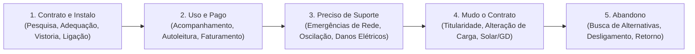

# Dossiê Executivo & Síntese Profunda: Neoenergia — Conexão Digital (P&D ANEEL)
## Mapeamento Integral de Jornadas, Service Blueprinting & Arquitetura Omnicanal

**Data de Atualização:** 02 de Novembro de 2026  
**Iniciativa:** Programa Estratégico de Pesquisa e Desenvolvimento Tecnológico (P&D ANEEL) — Experiência do Consumidor  
**Consórcio Estratégico:** Ernst & Young (EY Business Transformation) × Livework Brasil  
**Cliente:** Grupo Neoenergia (Iberdrola Brasil) — Concessionárias Elektro (SP/MS), Coelba (BA), Celpe (PE) e Cosern (RN)  
**Papel Documentado:** Israel Rozar — Liderança Técnica de Service Design, CX/UX e Arquitetura de Informação  
**Fontes Primárias Auditadas:**
- `Drive Oficial (13Jahrxh9R6ktCYFh4sJRzZ_ZcXqinlC4):`
  - `1. CONTRATO E INSTALO.pdf` (Blueprint As-Is)
  - `2. USO E PAGO - Consumo.pdf` (Blueprint As-Is)
  - `3. PRECISO DE SUPORTE.png` (Blueprint As-Is - 12.808 × 16.848 px)
  - `4. MUDO O CONTRATO.png` (Blueprint As-Is - 1.632 × 4.212 px)
  - `5. ABANDONO.pdf` (Blueprint As-Is)
  - `11 - 118 IDEIAS.png` (Matriz de Co-criação e Priorização - 9.034 × 5.400 px)
  - `JORNADA DO FUTURO NEOENERGIA.pdf` (Blueprint To-Be e Matriz de Ganhos)
- `Google Slides (1rISX29_0... / 1BUOb36yK... / 1GsxcSgYd...):` Relatório Integrado de Entregas (74 slides), Governança e Metodologia em 6 etapas.
- `Figma (lbt8CIcNIS... / u9EZbfBXe...):` Matriz de Inovação e Tendências.

---

## 1. Sumário Executivo & Números Vitais do Ecossistema

O projeto **Conexão Digital** consolidou o maior esforço de redesenho de serviços essenciais de infraestrutura pública já realizado no setor elétrico nacional sob a regulação da **ANEEL**. A Neoenergia, sob a holding **Iberdrola**, opera em 18 estados brasileiros atendendo 17% da população do país.

O mandato central foi romper o isolamento histórico entre quatro concessionárias reguladas e diagnosticar por que clientes enfrentavam atritos contínuos em processos básicos, substituindo automações internas isoladas (em silos) por uma experiência omnicanal contínua, acessível e preditiva.

```
+----------------------------------------------------------------------------------------------------+
|                                    GRANDES NÚMEROS AUDITADOS                                       |
+----------------------------------------------------------------------------------------------------+
|  18 Estados Brasileiros com presença operacional e 1.028 municípios atendidos                      |
|  34 Milhões de Habitantes na área de concessão (17% da população de todo o Brasil)                 |
|  13,9 Milhões de Clientes / Unidades Consumidoras ativas faturadas mensalmente                     |
|  4 Distribuidoras integradas: Elektro (SP/MS), Coelba (BA), Celpe (PE) e Cosern (RN)               |
|  840.000 km de Redes Elétricas em 619.000 km² de concessão territorial                             |
|  5 Macro-Etapas do Ciclo de Vida do Cliente mapeadas em Blueprints de Serviço de alta fidelidade   |
|  3 Perfis Canônicos de Consumidores: Pequenos (PF/PJ), Administradores/Especialistas e Grandes (PJ)|
|  25 Serviços Regulados prioritários x 8 variantes (Digital x Offline x 4 marcas) = 200 Jornadas    |
|  118 Ideias Estratégicas Priorizadas na Matriz de Impacto de Negócio vs. Valor Percebido           |
|  11 Canais Omnicanal estruturados com diretrizes de usabilidade e acessibilidade WCAG 2.1 AA       |
+----------------------------------------------------------------------------------------------------+
```

---

## 2. As 5 Macro-Etapas da Jornada do Cliente (Diagnóstico As-Is)

A investigação de campo e a auditoria de backstage estruturaram a jornada do consumidor em cinco grandes estágios interconectados:



---

### Macro-Etapa 1: Contrato e Instalo
* **Sub-etapas:** `1.1 Pesquiso Informações` | `1.2 Contrato o Serviço` | `1.3 Recebo a Equipe e Tenho a Energia Ligada`
* **Ações do Consumidor:**
  1. Preciso ligar a energia na Unidade Consumidora (UC).
  2. Busco informações sobre opções e etapas do processo.
  3. Procuro o apoio de especialistas (eletricistas, projetistas).
  4. Contrato o consumo de energia.
  5. Realizo adequações nas instalações internas.
  6. Solicito a ligação para a distribuidora.
  7. Recebo confirmação e aguardo a vistoria técnica.
  8. Recebo equipe técnica para vistoria e aprovação.
  9. Recebo equipe técnica e tenho a energia ligada.
* **Dores Latentes por Perfil:**
  * *Pequenos Clientes (PF/PJ):* Dificuldade extrema para decifrar termos técnicos de engenharia elétrica; nome negativado inviabilizando a ligação; falta de flexibilidade no agendamento da vistoria.
  * *Administradores e Especialistas:* Falta de clareza sobre normas de padrão de entrada; dificuldade para encontrar parceiros homologados; frustração com reprovações de vistoria por divergências mínimas de padrão.
  * *Grandes Clientes (PJ):* Prejuízos financeiros brutais por atraso na energização de galpões e indústrias (gerando custos com geradores a diesel alugados); falta de visibilidade sobre o prazo de obras de extensão de rede da concessionária.
* **Análise Interna & Silos Operacionais:**
  * **O Gargalo das Três Notas:** Para atender a um protocolo de nova ligação, os sistemas internos geravam de forma desintegrada três Ordens de Serviço (OS): *Nota de Solicitação*, *Nota de Obra* e *Nota de Ligação*. A falta de comunicação entre atendimento, planejamento de engenharia e equipes de campo provocava deslocamentos improdutivos repetidos, aumentando os custos da distribuidora.
* **Oportunidades To-Be Estruturadas:**
  * Criação do **Manual Interativo Digital** e **Catálogo de Especialistas Homologados** geolocalizados;
  * Consulta prévia online de capacidade e viabilidade de rede integrada a GIS/geolocalização;
  * Triagem digital inteligente para ligação nova, eliminando vistorias presenciais desnecessárias.

---

### Macro-Etapa 2: Uso e Pago
* **Sub-etapas:** `2.1 Acompanho o Consumo` | `2.2 Realizo o Pagamento`
* **Ações do Consumidor:**
  1. Começo a usufruir da energia no dia a dia.
  2. Busco estratégias para reduzir gastos e otimizar consumo.
  3. Tenho o consumo mensurado (leiturista ou autoleitura).
  4. Acesso e analiso a cobrança.
  5. Realizo o pagamento.
* **Dores Latentes por Perfil:**
  * *Pequenos Clientes (PF/PJ):* A fatura é percebida como uma "caixa preta": impossibilidade de compreender impostos (ICMS, PIS/COFINS), encargos setoriais e bandeiras tarifárias; estresse severo com a cobrança por **faturamento pela média** (quando o leiturista não tem acesso ao relógio ou não passa); desvio de faturas físicas pelos Correios em áreas de difícil acesso.
  * *Administradores e Especialistas:* Falta de ferramentas preditivas para simular variações de consumo ao adicionar máquinas ou equipamentos.
  * *Grandes Clientes (PJ):* Complexidade absurda para gerenciar e conciliar centenas de faturas mensais emitidas em datas e formatos divergentes entre distribuidoras.
* **Análise Interna & Silos Operacionais:**
  * Falta de canais digitais confiáveis para autoleitura; atendimento despreparado para orientar clientes sobre fuga de corrente em instalações internas; desconfiança em relação às equipes de campo (suspeitas de manipulação do medidor ou fiscalizações coercitivas).
* **Oportunidades To-Be Estruturadas:**
  * **Fatura Inteligente & Didática:** Decomposição visual dos hábitos de consumo com dicas práticas de eficiência energética;
  * **Autoleitura com IA / OCR:** Validação em tempo real da foto do visor do medidor diretamente pelo aplicativo, eliminando o faturamento por média;
  * **Portal Multi-Faturas B2B:** Centralização de faturamento e conciliação em lote para frotas de imóveis e clientes corporativos.

---

### Macro-Etapa 3: Preciso de Suporte
* **Sub-etapas:** `3.1 Falta de Energia (Emergência de Rede)` | `3.2 Oscilação e Ressarcimento de Danos Elétricos (RDE)` | `3.3 Dúvidas Comerciais`
* **Dores Latentes por Perfil:**
  * Pânico, perda de alimentos perecíveis e paralisação de negócios durante apagões e intempéries climáticas;
  * Sobrecarga e colapso das centrais de atendimento telefônico (0800) em tempestades;
  * Burocracia hercúlea para solicitar ressarcimento de aparelhos elétricos queimados (RDE) por oscilação de tensão, exigindo laudos técnicos caros e prazos regulatórios exaustivos da ANEEL.
* **Análise Interna & Silos Operacionais:**
  * O Centro de Operações da Distribuição (COD) operava sem sincronia em tempo real com a URA do call center e as interfaces digitais. A equipe de atendimento desconhecia o status das equipes de campo, fornecendo respostas vagas ("já estamos verificando").
* **Oportunidades To-Be Estruturadas:**
  * **Notificação Preditiva de Quedas de Energia:** Disparo proativo de SMS e Push avisando que a distribuidora já detectou a falha no transformador do bairro, informando estimativa de retorno e rastreamento da equipe;
  * **Canal Digital RDE Desburocratizado:** Abertura de sinistro com envio de fotos de notas fiscais e comprovantes pelo aplicativo.

---

### Macro-Etapa 4: Mudo o Contrato
* **Sub-etapas:** `4.1 Troca de Titularidade` | `4.2 Alteração de Carga e Migração (Solar GD / Mercado Livre)`
* **Dores Latentes por Perfil:**
  * Novos inquilinos impedidos de ligar a energia devido a dívidas não quitadas deixadas por antigos locatários;
  * Proprietários com CPF indevidamente negativado por falta de desvinculação ágil;
  * Lentidão e opacidade na análise de projetos de Geração Distribuída (energia solar fotovoltaica), com atrasos de meses para obter o Parecer de Acesso e a troca do relógio para medidor bidirecional.
* **Análise Interna & Silos Operacionais:**
  * Regras contratuais rígidas que atrelavam a dívida à Unidade Consumidora (UC) em vez de ao CPF do devedor real; sistemas legados exigindo validações manuais de cartório e contratos físicos de locação.
* **Oportunidades To-Be Estruturadas:**
  * **Troca de Titularidade Digital Instantânea:** Validação documental por OCR e biometria facial, desvinculando imediatamente o histórico financeiro do antigo ocupante;
  * **Portal do Integrador Solar:** Rastreamento ponta a ponta de todas as etapas de homologação do projeto fotovoltaico com transparência de prazos da ANEEL.

---

### Macro-Etapa 5: Abandono
* **Sub-etapas:** `5.1 Busco Fonte Alternativa de Energia` | `5.2 Encerro o Contrato` | `5.3 Retorno`
* **Dores Latentes por Perfil:**
  * Famílias em vulnerabilidade social extrema recorrendo a ligações clandestinas ("gatos") diante da demora na regularização formal ou incapacidade de pagamento, gerando riscos fatais de choques elétricos e incêndios;
  * Dificuldade de solicitar o desligamento definitivo ao desocupar o imóvel, gerando cobranças indevidas de taxa de disponibilidade mínima;
  * Desgastes e litígios entre locadores, imobiliárias e ex-inquilinos.
* **Análise Interna & Silos Operacionais:**
  * Falhas na notificação de fraudes (cartas que não chegam em áreas rurais); ausência de automatização para encerramento de contrato; deslocamentos improdutivos de equipes de corte e religa.
* **Oportunidades To-Be Estruturadas:**
  * Modelos de tarifas sociais acessíveis e contratações simplificadas para comunidades vulneráveis;
  * Encerramento contratual digital imediato com envio de foto do medidor na entrega das chaves;
  * Regularização humanizada e segura de ligações comunitárias.

---

## 3. Matriz de Co-criação: As 118 Ideias & A Jornada do Futuro (To-Be)

Na fase **The Art of the Possible**, a squad multidisciplinar da EY e Livework conduziu dinâmicas de Design Thinking que consolidaram **118 ideias de inovação** organizadas na Matriz de Priorização Estratégica:

| Cluster Estratégico | Ideias-Chave do Blueprint To-Be | Impacto no Negócio (Inside-Out) | Valor Percebido pelo Cliente (Outside-In) |
| :--- | :--- | :--- | :--- |
| **1. Autosserviço Preditivo** | • Manual Interativo Digital<br/>• Triagem Digital para Nova Ligação<br/>• Autoleitura guiada por IA | Redução de até 40% nas chamadas repetidas ao 0800 e visitas improdutivas a agências físicas. | Resolução imediata em menos de 3 minutos sem filas nem espera telefônica. |
| **2. Integração de Backstage** | • Unificação das 3 OSs em protocolo único<br/>• Integração COD × URA × App<br/>• Rastreamento de equipes em tempo real | Otimização massiva da frota de campo e cumprimento rigoroso das metas de DEC/FEC da ANEEL. | Fim da incerteza: saber exatamente quando a luz voltará ou quando o técnico chegará. |
| **3. Transparência na Cobrança** | • Fatura Didática com detalhamento por aparelho<br/>• Simulação de consumo online<br/>• Desacoplamento de dívida de terceiros | Queda drástica em contestações judiciais, litígios no Procon e perdas comerciais. | Relação de confiança restaurada com a concessionária de energia. |
| **4. Ecossistema de Parceiros** | • Catálogo de Eletricistas e Especialistas Homologados<br/>• Portal do Integrador Solar GD | Aceleração da transição energética e captação de clientes qualificados. | Segurança técnica na contratação de profissionais certificados. |

---

## 4. O Papel Documentado de Israel Rozar no Consórcio EY × Livework

A documentação primária (slides 63 e 64 do Relatório Integrado) comprova formalmente a atuação de **Israel Rozar** como **Liderança Técnica de Service Design e Experiência do Consumidor** na equipe de Business Transformation da EY:

* **Condução do Diagnóstico Qualitativo:** Liderança na elaboração dos roteiros de entrevistas, acompanhamento presencial de atendentes (shadowing) e análise comportamental omnicanal;
* **Modelagem e Arquitetura dos Blueprints:** Estruturação das 5 macro-etapas, decomposição das ações do cliente, mapeamento de processos internos de TI/Backoffice e catalogação das dores por perfil;
* **Facilitação da Matriz de 118 Ideias:** Co-condução de workshops multidisciplinares com stakeholders executivos da Neoenergia;
* **Arquitetura Multi-Tenant de UI & Design System:** Concepção da fundação de componentes com tematização dinâmica para suportar simultaneamente Elektro, Coelba, Celpe e Cosern sob as diretrizes de acessibilidade WCAG 2.1 AA.

---

## 5. Rastreabilidade das Fontes & Limites Metodológicos Declarados

* **Natureza dos Artefatos:** Os blueprints e diagramas foram renderizados em resolução ultra-alta (até 2000 px de largura) a partir dos arquivos vetoriais originais do Google Drive oficial do projeto.
* **Escopo Declarado:** Os dados de 34 milhões de habitantes, 13,9 milhões de clientes e 200 jornadas derivam do contrato oficial de P&D ANEEL e das bases demográficas das concessionárias do Grupo Neoenergia.
* **Resultados e Continuidade:** O projeto entregou o diagnóstico, a matriz de priorização, as diretrizes de arquitetura e o blueprint To-Be que nortearam os anos subsequentes de desenvolvimento de software e transformação digital da Neoenergia.

---
*Dossiê consolidado com base nas fontes primárias auditadas no Google Drive, Google Slides e Figma oficiais do projeto.*
