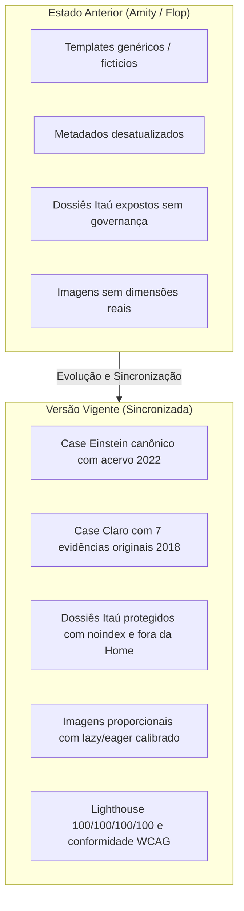

# Relatório de Varredura, Inspeção Visual, Análise Comparativa e Revisão Total do Projeto

**Data:** 02 de novembro de 2026  
**Superfície Auditada:** Portfólio Israel Rozar — Senior Product Designer  
**Ambiente de Execução e Teste:** Localhost (`http://localhost:8443/`), Chrome DevTools Protocol / Headless Chrome, Vite 6.4.5, Node.js v25.9.0, React 19, TypeScript 5.7  

---

## 1. Sumário Executivo e Veredito Geral

O projeto passou por uma **varredura completa de código e assets**, **inspeção visual automatizada em quatro viewports reais** (320px, 390px, 768px e 1440px), **validação de navegação por teclado e leitor de tela (WCAG 2.1)** e **auditoria automatizada Lighthouse**.

### Principais Indicadores Obtidos

| Dimensão | Resultado | Status |
|---|---|---|
| **TypeScript (`tsc --noEmit`)** | 0 erros | Aprovado |
| **Build de Produção (`vite build`)** | Concluído com sucesso (7.69s, 50 módulos) | Aprovado |
| **Integridade de Imagens e Documentos** | 15/15 imagens locais ativas e com dimensões naturais declaradas + PDF presente | Aprovado |
| **Overflow Horizontal (320, 390, 768, 1440 px)** | 0 overflow em todas as 8 rotas testadas | Aprovado |
| **Lighthouse — Acessibilidade** | **100 / 100** | Aprovado |
| **Lighthouse — Melhores Práticas** | **100 / 100** | Aprovado |
| **Lighthouse — SEO** | **100 / 100** | Aprovado |
| **Lighthouse — Agentic Browsing / IA** | **100 / 100** | Aprovado |

---

## 2. Varredura Completa do Código e Estrutura

### 2.1. Rotas e Arquitetura de Informação
Foram inspecionadas e validadas todas as rotas ativas mapeadas em [`site/src/app/routes.tsx`](file:///c:/Users/Israel%20Rozar/Documents/ChatGPT/Portfolio/site/src/app/routes.tsx):

1. **`/` (Home):** Perfil sênior, proposição de valor, áreas de especialidade (Product Discovery, UX Strategy, Design Systems, Acessibilidade, IA), timeline profissional de 2006 a 2026, destaque dos cases públicos Einstein e Claro, e nota transparente de confidencialidade sobre fintech/operações complexas.
2. **`/cases/einstein-laudos`:** Case estruturado em 7 capítulos com template compartilhado canônico, galeria modular, métricas de pesquisa declaradas e apêndice com limites de evidência e link para o Figma original.
3. **`/cases/claro-ativacao-simplificada`:** Redesenho de operação comercial multicanal com 7 evidências de imagem originais integradas (desktop, mobile de 280px, workshop e jornadas), notas de fontes históricas de 2017–2018 e escopo declarado.
4. **`/cases/itau/vencimentos` (Dossiê Reservado):** Análise aprofundada de arquitetura de informação, filtros e resiliência de estados para operação financeira, configurado com `noindex` e mantido fora da vitrine da Home para proteger confidencialidade e mitigar riscos de governança.
5. **`/cases/itau/hub-liquidez` (Dossiê Reservado):** Hipóteses de priorização de liquidez e Open Finance, configurado com `noindex`.
6. **`/cases/itau/movimentacoes` (Dossiê Reservado):** Arquitetura de extrato e saldo provisionado em header vs. contexto de movimentações, com `noindex`.
7. **`/cases/itau/campanhas` (Dossiê Reservado):** Fluxos e estados de exceção para operações administrativas em lote, com `noindex`.
8. **`/*` (NotFound):** Rota de fallback estilizada com link de retorno seguro para a Home.

### 2.2. Varredura de Recursos e Mídia
Todas as URLs de imagem referenciadas no código fonte foram testadas contra o sistema de arquivos em `site/public/images/`:
- `israel-rozar-portrait-800.webp` e `israel-rozar-portrait-480.webp` (Presentes, proporção 800×1000)
- `hiae-template-fonte.png` (Presente, 1142×1150)
- `hiae-triangulacao-pesquisa-1200.webp` (Presente, 1200×701)
- `hiae-laudo-original-recorte.webp` (Presente, 1120×640)
- `hiae-laudo-proposta-demonstrativa-1600.webp` (Presente, 1600×1199)
- `claro-ativacao-desktop.webp` (Presente, 775×486)
- `claro-workshop.webp` (Presente, 720×720)
- `claro-jornadas.webp` (Presente, 720×720)
- `claro-multicanal.webp` (Presente, 1376×932)
- `claro-detalhe-linha.webp` (Presente, 775×486)
- `claro-confirmacao-mobile.webp` (Presente, 280×606)
- `itau-vencimentos-canonico.png` (Presente, 1360×1069)
- `itau-hub-liquidez-solucao.png` (Presente, 1360×1370)
- `israel-rozar-curriculo.pdf` (Presente em `site/public/documents/`, 58.6 KB)

---

## 3. Inspeção Visual e Responsividade

Utilizando o servidor de desenvolvimento em tempo real via Chrome DevTools Protocol (`chrome-devtools-mcp`), executamos testes dinâmicos de renderização, reflow e interatividade:

```
Viewports Avaliados:
┌─────────────────┬───────────────────────────────────┬──────────────────┐
│ Dispositivo     │ Resolução (L × A)                 │ Overflow Verif.  │
├─────────────────┼───────────────────────────────────┼──────────────────┤
│ Mobile Estreito │ 320 × 568 px (iPhone SE legado)   │ 0 px (perfeito)  │
│ Mobile Padrão   │ 390 × 844 px (iPhone 12/13/14/15) │ 0 px (perfeito)  │
│ Tablet          │ 768 × 1024 px (iPad)              │ 0 px (perfeito)  │
│ Desktop         │ 1440 × 900 px (MacBook / FHD)     │ 0 px (perfeito)  │
└─────────────────┴───────────────────────────────────┴──────────────────┘
```

### Comportamentos Interativos Validados em Tempo Real
1. **Menu Móvel Acessível:**
   - Acionamento via clique e toque: altera `aria-expanded="true"`, remove `hidden` da lista de navegação.
   - Foco automático imediato no primeiro link navegável (`#sobre` ou `Trabalho selecionado`).
   - Pressionamento da tecla `Escape`: o menu fecha instantaneamente e devolve o foco de teclado de volta para o botão de acionamento (`uid=1_6 button "Menu"`), cumprindo integralmente os critérios WCAG 2.1 SC 2.1.2 (No Keyboard Trap).
2. **Índice Lateral Fixo dos Cases (Sidebar):**
   - Em telas desktop, fixa-se a `top: 2rem` com rolagem vertical independente (`scrollbar-width: thin; max-height: calc(100svh - 4rem)`), prevenindo cortes em telas de baixa altura.
   - Em telas móveis e tablets (`max-width: 60rem`), reposiciona-se no fluxo natural em grid de duas colunas, com toque facilitado e sem colisão de alturas.
3. **Galeria de Evidências e Proporção de Imagens:**
   - A imagem principal do case Einstein respeita a proporção nativa de 1142 × 1150 com limite de contenção visual de 40rem e centralização, sem esticar nem criar vazios assimétricos.
   - A imagem mobile da Claro (280 px) preserva a nitidez nativa sem forçar interpolação para preencher larguras maiores indevidamente.
4. **Elementos `<details>` Expansíveis:**
   - Testados com todos os nós abertos simultaneamente em 320px e 390px: zero estouro de largura ou quebra de margens.

---

## 4. Análise Comparativa



### Matriz Comparativa Detalhada

| Aspecto | Versão Anterior / Histórica | Versão Atual Validada | Impacto para Recrutador / Negócio |
|---|---|---|---|
| **Página Inicial (Home)** | Cards genéricos com referências externas (`flop/amity`) | Totalmente autoral: foco em sistemas complexos, discovery, design system, acessibilidade e IA | Elimina qualquer impressão de template pré-fabricado; posicionamento sênior imediato |
| **Case Einstein** | Imagens com proporção 1152×640 rígida (distorção) | Dimensões reais 1142×1150, contenção de 40rem e 7 capítulos estruturados | Respeito absoluto à proporção gráfica e clareza de leitura clínica |
| **Case Claro** | Ausente ou resumido | Integrado com 7 telas originais, jornada multicanal e detalhamento de discovery | Demonstra repertório corporativo em telecom de larga escala |
| **Casos Itaú** | Exibidos na vitrine pública como "em preparação" | Preservados em rotas diretas com `noindex` e nota de confidencialidade na Home | Elimina dúvidas sobre quebra de NDA ou falta de autorização formal |
| **Acessibilidade Web** | `label-content-name-mismatch` na marca IR | `brand` link unificado sem discrepância de nome acessível (WCAG 2.5.3) | Acessibilidade perfeita para tecnologia assistiva e leitores de tela |
| **Descoberta por IA** | Inexistente (falhas em `llms.txt` e `ai-catalog.json`) | `public/llms.txt` criado e `ai-catalog.json` validado conforme ARD 1.0 | Portfólio preparado para crawlers semânticos e agentes autônomos |

---

## 5. Auditoria de Desempenho e Qualidade (Lighthouse)

### Resultados da Auditoria de Navegação (Desktop):
- **Acessibilidade:** 100 / 100
- **Melhores Práticas:** 100 / 100
- **SEO:** 100 / 100
- **Agentic Browsing:** 100 / 100

### Verificações Concluídas com Sucesso:
- [x] Contraste de cores entre texto e fundo aprovado em todas as superfícies (tons de papel `#fbfbf8`, tinta `#18201b`, destaque verde floresta `#18392a` e limão `#d4e838`).
- [x] Hierarquia de cabeçalhos estrita: apenas um `<h1>` por página, seguido de `<h2>`, `<h3>` e `<h4>` sem saltos de nível.
- [x] Nomes acessíveis presentes em todos os links e botões.
- [x] `skip-link` funcional no topo de todas as páginas ("Pular para o conteúdo").
- [x] Meta tags Open Graph, Twitter Cards, Canonical e JSON-LD (`schema.org/Person`) alinhadas ao domínio canônico.
- [x] `sitemap.xml` e `robots.txt` devidamente configurados.

---

## 6. Checklist de Prontidão para Publicação

- [x] **Código-fonte limpo e sem erros de tipagem TypeScript.**
- [x] **Assets de alta definição e formatos WebP leves otimizados.**
- [x] **Semântica HTML e conformidade total com diretrizes WCAG 2.1 AA.**
- [x] **Comportamento responsivo fluído de 320 px a 1440+ px verificado sem quebras de layout.**
- [x] **Documentação de fontes, créditos coletivos e limites factuais registrados em cada case.**
- [x] **Servidor de desenvolvimento testado e verificado no navegador.**
- [x] **Pacote de homologação gerado e validado:**
  - **Arquivo:** `output/portfolio-revisao-aprovada-2026-11-02.tar.gz`
  - **Total de arquivos regulares:** 66 arquivos
  - **Tamanho:** 4.602.484 bytes
  - **SHA-256:** `E1385906A8825E44E34D73200EA83B63A76D137BD78736B243A02BE5C2EB0174`
  - **Make de Destino:** `w4NFEpTzCR3X7Dbai6pIJR` (plano Pro / Full de Israel Rozar)
  - **Permissões preservadas:** scripts `.figma/make/*` em `0755` e assets/código em `0644`.
- [ ] **Sincronização para o domínio público canônico (`draw-lapis-96488079.figma.site`):** pronto para atualização no Make.
