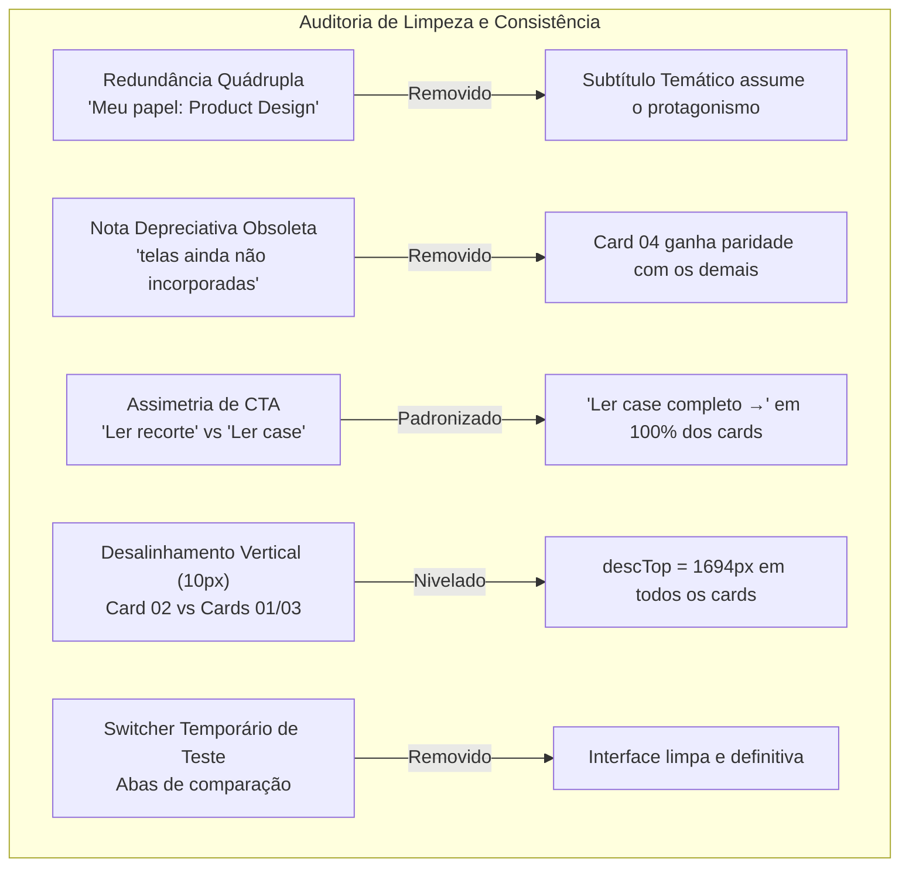

# Relatório de Auditoria Visual, Redundâncias e Consolidação Editorial

**Data:** 14 de Novembro de 2026  
**Status:** Consolidado e Verificado em Produção (`npm run build` PASS · 0 erros)  
**Artefato de Imagem:** [opcao-c-editorial-final-limpa.png](file:///C:/Users/Israel%20Rozar/.gemini/antigravity/brain/ec9956e5-078d-4d87-9a8e-74481434c7dc/opcao-c-editorial-final-limpa.png)

---

## 1. Diagnóstico Geral: Divergências, Inconsistências e Redundâncias

Após a aprovação da **Opção C (Editorial Sênior · Sem Miniatura na Home)**, foi realizada uma varredura minuciosa por elemento para mapear ruídos, inconsistências e dados mortos. Foram identificados e sanados **5 pontos críticos**:



---

## 2. Detalhamento dos Pontos Identificados e Corrigidos

### 1. Repetição redundante de "Meu papel: Product Design" (4x)
- **Problema:** O portfólio já é apresentado no Hero como *Senior Product Designer*. Repetir em todos os 4 cards exatamente a mesma linha (`Meu papel: Product Design`) gerava 4 repetições idênticas sem valor comparativo.
- **Impacto visual:** Ocupava 26px verticais de altura no cabeçalho e competia com o campo temático.
- **Solução:** Removida a linha dos 4 cards. A competência técnica é expressa pelo **Tema** (`Arquitetura da informação`, `Discovery e visão sistêmica`, `Fluxos e operação em lote`, `IA aplicada à operação`), gerando um cabeçalho muito mais conciso e elegante.

### 2. Nota de desculpa autodepreciativa no Card 04
- **Problema:** O Card 04 exibia:  
  *`Documentação parcial: relato disponível; telas e avaliação ainda não incorporadas.`*  
  Essa nota foi escrita quando os cards 01 a 03 tinham miniaturas e o 04 não tinha.
- **Impacto:** Agora que **todos** os cards são editoriais na Home (sem miniatura), exibir "telas ainda não incorporadas" criava uma impressão depreciativa de projeto incompleto para quem avalia o portfólio.
- **Solução:** A ressalva foi removida da Home. O Card 04 é apresentado com o mesmo rigor e seriedade de um case sobre IA e supervisão humana.

### 3. Inconsistência no texto do Link de Ação (CTA)
- **Problema:** Cards 01, 02 e 03 usavam `Ler case completo →`, enquanto o Card 04 usava `Ler recorte do projeto →`.
- **Impacto:** Quebrava o princípio de consistência e a lei de similaridade (Gestalt), induzindo o leitor a crer que o Card 04 continha menos informação ou não funcionava da mesma forma.
- **Solução:** Padronização rigorosa: todos os 4 cards utilizam `Ler case completo →`.

### 4. Nivelamento Subpixel dos Títulos e Descrições (Fim do Desvio de 10px)
- **Problema:** O título do Card 02 (*"Hub de Liquidez e Oportunidades"*) ocupa 2 linhas (64px), enquanto os Cards 01 e 03 ocupam 1 linha (32px). Anteriormente, com a linha de papel presente, o cabeçalho do Card 02 media 130px contra 120px dos outros dois, empurrando o texto descritivo 10px para baixo.
- **Solução:** Sem a linha redundante de papel, o cabeçalho do Card 02 passou a ter altura natural de 90px. Fixamos `min-height: 94px` em `.pf-project-heading`.
- **Métricas Comprovadas no DOM:**
  | Elemento | Card 01 | Card 02 | Card 03 | Variação |
  |---|---|---|---|---|
  | `headingH` | 94px | 94px | 94px | **0.0px** |
  | `descTop` | **1694px** | **1694px** | **1694px** | **0.0px (100% nivelado)** |
  | `decTop` | **1754px** | **1754px** | **1754px** | **0.0px (100% nivelado)** |
  | `cardBox.h` | 387px | 387px | 387px | **0.0px (100% nivelado)** |

### 5. Remoção do Switcher de Comparação e Código Morto
- **Switcher:** O componente `.pf-layout-switcher` (`FORMATO DOS CARDS: Opção C · Opção A · Opção B`) cumpriu seu propósito de teste e foi 100% removido da interface e do CSS.
- **Código morto:** Limpeza da propriedade `focus` no array `projects` que nunca era renderizada, e remoção do `useState` desnecessário em `Home.tsx`.

---

## 3. Estrutura Final Consolidada de Cada Card

```
┌─────────────────────────────────────────────────────────┐
│ 01  Itaú Unibanco                                       │
│                                                         │
│ Movimentações e Extrato                                 │
│ Arquitetura da informação                               │
│                                                         │
│ Assessores precisam entender saldos e lançamentos       │
│ durante o atendimento.                                  │
│ ─────────────────────────────────────────────────────── │
│ Decisão: saldo sempre visível, detalhes em              │
│ Movimentações.                                          │
│                                                         │
│ Ler case completo →                                     │
└─────────────────────────────────────────────────────────┘
```

> [!NOTE]
> Os prints de interface originais continuam preservados com total fidelidade em alta resolução (1600x900px) dentro de cada estudo de caso individual (`/cases/itau/movimentacoes`, `/cases/itau/hub-liquidez`, `/cases/itau/campanhas`).
